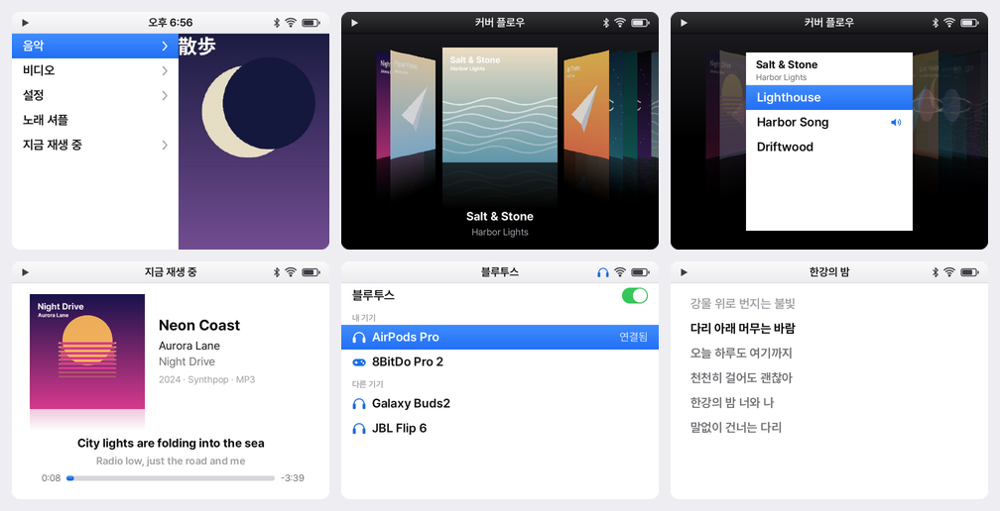

# isoPod

A music-first operating system for the Anbernic RG35XX SP, in the spirit of the iPod video.
isoPod keeps ROCKNIX's kernel, drivers, bootloader and build system as they are, and
replaces the front end with a small shell built around your music.



## What you get

- **Music** from `/storage/music`: Cover Flow, Playlists, Artists, Albums, Songs, Genres,
  Up Next and Search. Playback carries on in the background, whatever else is open, and a
  sleep timer in Now Playing stops it for you.
- **Now Playing** shows the song's cover over its reflection, its title, artist and album,
  and a line with its year, genre and kind of file. With timed lyrics the line being sung
  and the one after it stand under the cover.
- **Favorites**: X on a song, in a list or in Now Playing, makes it a favorite or no longer
  one. Favorites is the first of the playlists, and a star marks a favorite wherever it is
  listed. They are kept as `Favorites.m3u` in the music folder, a playlist like any other,
  to be copied off with the music or edited on a computer.
- **Playlists** are the `.m3u` files in the music folder, wherever they lie in it, so a
  playlist comes over the cable as its songs do. A line names a song by its path from the
  playlist's own folder or from the music folder. A playlist exported on a computer, with
  that computer's paths, finds the songs that sit in the same folders under the same names
  here.
- **Radio**: stations from [Radio Browser](https://www.radio-browser.info), under Favorites,
  Popular, Genres, Countries and Search. A list is fetched the first time it is opened and
  kept on the card with its logos. Opened a week or more later it shows at once as it was,
  and is fetched again behind that when the network is there. X on a station makes it a
  favorite.
- **Podcasts** from Apple's directory, the one place asked: found by name or among the most
  listened to, under Subscriptions, Downloads, Popular and Search. A show's newest 200
  episodes come as Apple has them from its feed, in a few hundred kilobytes, and are kept on
  the card and asked for again behind them when they are an hour old; one that came out
  lately and has not been heard has a blue dot before it, as on the iPod. An episode plays
  from the web, its address followed past the listener counters' redirects first, or from the
  card once X has downloaded it; nothing is downloaded unless it is asked for, and one that
  will not play from the web says so and can be downloaded instead. Each episode keeps its
  place. What is subscribed to is `Subscriptions.opml` in the podcasts folder, beside the
  downloads, and one exported by another podcast app is matched to Apple's shows by feed.
- **Audiobooks**, in the Books menu beside eBooks, from `/storage/audiobooks`: a folder of
  files, one for each chapter or part (or `CD 1`, `CD 2` folders of them), or one file. An
  M4B's own chapters are read from it, and a folder of M4Bs is a shelf of books, an
  author's say. A book starts where it was left, and X lists its chapters or starts it over.
- **Lyrics**, all of them, are a press of Y away: timed lyrics follow the line being sung,
  plain ones scroll. They come from an `.lrc` or `.txt` file beside the song and named
  like it (`Song.mp3`, `Song.lrc`), or from the song's own tags.
- **Covers** come from each song's own artwork, one per album, or from a `cover.jpg` in
  its folder.
- **Search** with an on-screen keyboard that types Hangul as well as Latin; bare initials
  such as ㅎㄱ find 한강.
- **Videos** from `/storage/videos`, played by mpv: MP4, MKV, AVI, WebM, MOV and the rest.
  Subtitles beside the file (SRT, SMI, ASS, VTT) or inside it turn on by themselves, Korean
  first, and older Korean subtitle files read correctly. It remembers where you stopped.
- **eBooks** from `/storage/books`, read in [KOReader](https://koreader.rocks): EPUB, PDF,
  comics and the rest it opens. isoPod lists them, KOReader shows the one you pick with
  isoPod's buttons and a menu cut down to reading, and a book opens again at the page it
  was left on. KOReader's progress sync is kept, for a page shared with another reader
  through a sync server.
- **Bluetooth** headphones connect from one list in Settings, and Bluetooth left on is on
  again after a restart. A headset is told what is playing, so its own buttons pause and
  play, and skip to the next song or the one before.
- **Headphones**, wired or Bluetooth, take the sound when they arrive; with both, the one
  connected last plays. Unplugging or losing the one in use pauses music and videos before
  a note reaches the speaker.
- **Volume** is kept for each output on its own, the speaker, wired headphones and every
  Bluetooth headset, never above the limit, and each comes back where it was left after a
  restart. A headset's own volume buttons count.
- **Wi-Fi** remembers every network you join.
- **A cable** to a computer shows the libraries as an MTP device, `Music`, `Videos`, `Books`,
  `Audiobooks`, `Podcasts` and `Apps`, a second card being the `SD Card` folder in each of the
  first four. What is copied is in the
  library as it arrives, and isoPod stays awake for as long as the computer has it. A Mac
  needs an MTP app for this, such as OpenMTP.
- **Apps**: programs copied into the `Apps` folder, one folder each with an `app.json`, and
  listed under Apps on the home screen. A window app opens full screen
  and waits on the home screen as a book does; one that knows only a keyboard gets the
  buttons as keys. A list app gives isoPod its pages and what to play, and isoPod shows them
  as its own lists and plays them in its video player. How to make one:
  [docs/apps.md](docs/apps.md).
- **Multitasking**: a video or a book keeps its place. Home pauses it where it is, and the
  home screen lists it so you can pick it up again; Home pressed there goes straight back
  to it. Music and a video never sound together: starting one pauses the other.
- **Lid and power**: closing the lid turns the screen off and keeps the music playing,
  and a video that plays goes on too, to be heard without its picture. A book waits
  until the lid opens. With nothing playing the device sleeps, and opening the lid wakes
  it. Videos keep the screen on while they play.

## The look

The last iPod classic, brought forward. Menus split in two: the list on the left, and on
the right a panel where album art drifts slowly across, or the song playing, or the section
you are on: its colour, as an iPhone's icons have theirs, and a white disc with the
section's glyph in that colour, floating a little above the middle. Cover Flow turns the albums in 3D over a black floor
with their reflections, each side turned to face the middle; press A and the album flips
over to show its songs. Artwork stays square, as the covers are, and type is set in
Pretendard; names it cannot write, Japanese and Chinese among them, are set in Noto Sans CJK.

The title bar carries the time on the home screen, where the iPod wrote its name, and on
its right the battery (green with a bolt while it charges, red when low), Wi-Fi while it
is on (its bars once a network is joined, a faint fan until then) and Bluetooth while it
is on (headphones once a pair is connected). What is switched off is not drawn.

## The rules

Every screen is a list, and every list works the same way.

| Button | What it does |
| --- | --- |
| D-pad | Move. A press at the end of a list goes around to the other end; a held button stops there. In long lists ← and → jump to the previous or next letter; in Cover Flow they turn the albums |
| A | Open or choose |
| B | Back |
| X | Options for the selected item |
| Y | Now Playing |
| Start | Play or pause |
| Select | Control Center |
| L1, R1 | A page up or down in a list; in Cover Flow, which stands by artist and then by album, the artists of the letter before or after |
| L2, R2 | The song before and the one after, in any list and behind a book; nothing in a video |
| Home | Home screen; from an app, pause the app and come home; on the home screen, back to that app |
| Volume | Volume, always |
| Power | Turn the screen off or on; hold for Sleep, Restart and Shut Down |

In Now Playing, ← and → are the previous and the next song, and held they wind through the
song, as on an iPod; ← starts a song again once it is three seconds in. ↑ and ↓ change the
volume, and Y shows the lyrics. While a station is on, ← and → are the stations before and
after it in the list it was picked from. While an episode or a book plays, ← and → go back
fifteen seconds and ahead thirty, as L2, R2 and a headset's buttons do, and held they wind
as they do through a song; X goes to the episode's show, or lists the book's chapters.

The on-screen keyboard goes around its edges the way lists do.

In a video A or Start pauses, B leaves and remembers the spot, ← and → skip 10 seconds
and keep skipping while held, ↑ and ↓ change the volume. X switches the
audio track, Y the subtitles (as Y is the lyrics of a song), and Select shows where the
film is. A headset's buttons act on the video while it is in front and on the music
otherwise, and a paused video lets the screen go dark like any list.

In a book ←, → and A turn the page, as ↑ and ↓ do; B leaves, and the page is remembered.
X opens KOReader's menu (contents and bookmarks, type, the screen, tools, the book) and Y
the text's size and spacing, where the D-pad moves, A chooses and B goes back; under the
menu's icons and in a list, ← and → turn its pages where it has more than one. Select
starts a text selection: move the cross, A at its first word and A again at its last, then
highlight, note, copy, translate or search; Select again before that gives it up. Start
plays or pauses the music behind the page, and L2 and R2 change its song. L1 and R1 do
nothing there.

## How it fits together

| Part | Where | Role |
| --- | --- | --- |
| isopodd | `isopod/daemon` | Python asyncio daemon. Owns the buttons, the lid and the power key. Runs audio routing, Bluetooth, Wi-Fi, the MPD client and apps, and describes every screen |
| isopod-shell | `isopod/shell` | C and SDL2 renderer at 640×480. Draws what isopodd describes and nothing else |
| MPD | `projects/ROCKNIX/packages/isopod/mpd` | Plays music and radio through PipeWire |
| sway | ROCKNIX | Shows the shell on workspace 1 and each app on a workspace of its own |
| systemd | ROCKNIX | Runs each app as a transient unit, stopped (SIGSTOP) while it waits in the background |

The recipes that put these in the image are in `projects/ROCKNIX/packages/isopod`.

## Install on an RG35XX SP

1. Download `isopod-H700-images` from the latest
   [workflow run](https://github.com/isopod-player/isopod/actions/workflows/isopod-h700.yml).
   Pick the `DDR4` image for boards with LPDDR4 memory and the `DDR3` image for the rest.
2. Write the `.img.gz` to a microSD card with balenaEtcher or Raspberry Pi Imager.
3. On the card's `ISOPOD` partition, copy `device_trees/sun50i-h700-anbernic-rg35xx-sp.dtb`
   out of that folder to the top level, next to `KERNEL` and `SYSTEM`, and name the copy
   `dtb.img`; the original stays where it is. On a Mac, in Terminal:

   ```sh
   cp /Volumes/ISOPOD/device_trees/sun50i-h700-anbernic-rg35xx-sp.dtb /Volumes/ISOPOD/dtb.img
   ```

   Without it the bootloader has nothing to start Linux with, and the device shows only its
   red light. An SP with the newer panel takes `sun50i-h700-anbernic-rg35xx-sp-v2-panel.dtb`.
4. Add music, videos, books and audiobooks on a second microSD card (exFAT works with any
   computer): put them in its `music`, `videos`, `books` and `audiobooks` folders, lyrics
   beside their songs. isoPod
   creates the folders on first boot and shows the card as an `SD Card` folder in each
   library. With the card in the device, a USB cable to a computer reaches the same folders.

To update an installed isoPod, take the `.tar` from `isopod-H700-update` of a later run,
copy it to the `Update` storage over the cable (or to `/storage/.update` over SSH) and
restart.

SSH is off until the device has your public key, and takes no password: copy the key to
the `Update` storage as a file named `authorized_keys` and restart, then log in as `root`.

## Build

The image builds the same way ROCKNIX does, in its build container. isoPod ships no 32-bit
userland, so only the aarch64 pass is needed:

```sh
docker run --rm -it --init -v "$PWD":"$PWD" -w "$PWD" --user "$(id -u):$(id -g)" \
    ghcr.io/rocknix/rocknix-build:latest \
    bash -c "PROJECT=ROCKNIX DEVICE=H700 ARCH=aarch64 ./scripts/build_distro"
```

Pushes to the `isopod` branch are built by `.github/workflows/isopod-h700.yml`.

## Try it without the device

The simulator runs MPD, isopodd with simulated hardware and the shell offscreen, and saves
screenshots along a scripted walk. Set `ISOPOD_RECORD=/out/demo.mp4` and run
`isopod/tools/sim/demo.txt` to record the whole system as a captioned video.

```sh
docker build -t isopod-dev isopod/tools/dev
docker run --rm -v "$PWD":/src -v "$PWD/shots":/out -w /src isopod-dev \
    isopod/tools/sim/run.sh /src/isopod/tools/sim/tour.txt /out
```

`isopod/tools/sim/shots.sh` walks through every screen instead, one tour for each part of
the system, and files the screenshots by part with a sheet of thumbnails for each; the
last such walk is in [`docs/ui`](docs/ui).

```sh
docker run --rm -v "$PWD":/src -w /src isopod-dev isopod/tools/sim/shots.sh /src/isopod/docs/ui
```

The boot screen is a picture, `isopod/shell/assets/splash.ppm`, that takes the place of
ROCKNIX's logo once the system proper has started. Its pill bug is `isopod/art/pill-bug.png`:
put another square drawing on a clear background there and lay the screen out again with

```sh
docker run --rm -v "$PWD":/src -w /src/isopod/tools isopod-dev \
    python3 -c "import gen_assets; gen_assets.splash('../shell/assets')"
```

The desk runs the same system with a real mpv and KOReader under a headless sway and
records it: the storyboard in `isopod/tools/desk/demo.py` plays music with lyrics and
videos in four formats with their subtitles, switching between them, and reads a book.

```sh
docker build -t isopod-desk isopod/tools/desk
docker run --rm -v "$PWD":/src -v "$PWD/out":/out -w /src isopod-desk isopod/tools/desk/run.sh /out
```

Daemon tests: `python3 -m unittest discover -s isopod/daemon/tests`.

## Status

This is a demo. The shell, pages and the MPD client are exercised in the simulator, and
mpv and multitasking on the desk. The parts that talk to the hardware, BlueZ,
NetworkManager, PipeWire, evdev, stopping a real app in the background and suspend, still
need a pass on the device.

## Credits

isoPod is built on [ROCKNIX](https://github.com/ROCKNIX/distribution) and uses
[MPD](https://www.musicpd.org), [mpv](https://mpv.io), [KOReader](https://koreader.rocks),
[cJSON](https://github.com/DaveGamble/cJSON) and the
[Pretendard](https://github.com/orioncactus/pretendard) typeface.
